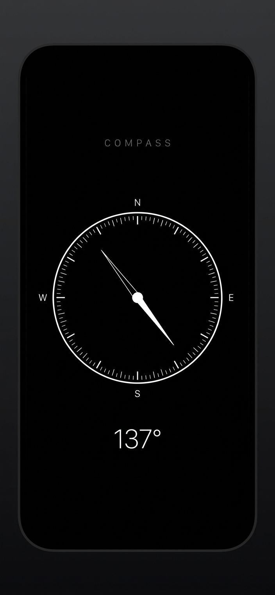
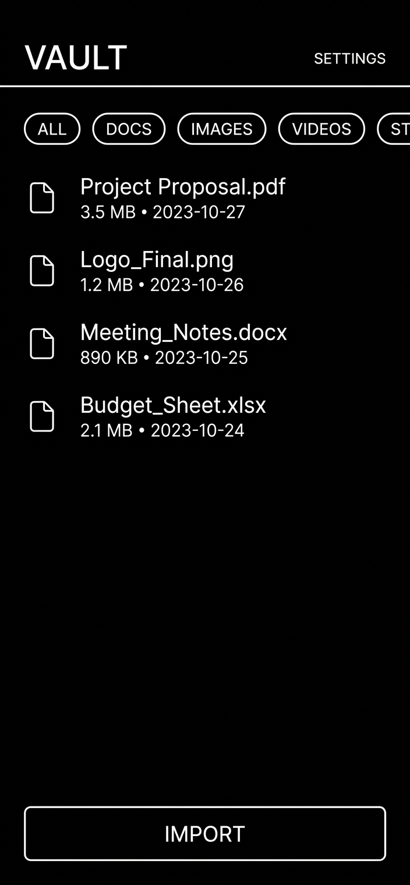
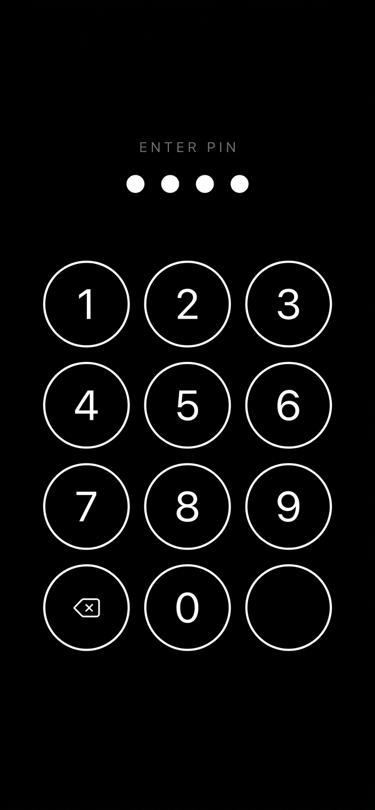

# Compass 2.4

**An offline file browser and secure vault, with a working compass.**

Compass 2.4 opens to a browsable local library for files Android exposes to
the app. A separate Locked Files area stores verified encrypted copies in
app-private storage. Tap the COMPASS heading to open the working compass
screen; the compass/PIN/biometric routes remain an app-level access gate, not
a substitute for Android device security.

<p align="center">
  
  
  
</p>

> *The three images above are **concept renderings** (mockups), not device
> screenshots. This Compass 2.4 source candidate passed repository self-tests
> and an offline build. A one-off test-signed APK is available in the Arena
> workspace for sideload testing; it has not been installed or tested on a
> device and is not a release. `COMPASS 0.2` is separate. See [Verification](#verification-status).*

---

## Table of contents

1. [How the disguise works](#how-the-disguise-works)
2. [Features](#features)
3. [Security model](#security-model)
4. [Build it](#build-it)
5. [Install it](#install-it)
6. [Project layout](#project-layout)
7. [Learn the code file by file](#learn-the-code-file-by-file)
8. [Three more ideas that fit this app](#three-more-ideas-that-fit-this-app)
9. [Verification status](#verification-status)
10. [Deviations from the original brief](#deviations-from-the-original-brief)
11. [Signing and release status](#signing-and-release-status)

---

## How access works

**The local library is the home screen.** Browse accessible MediaStore images,
video, and audio, plus files beneath a folder you explicitly choose in
Android's Storage Access Framework (SAF). The browser cannot crawl arbitrary
shared storage; documents/APKs outside granted locations are not visible or
protected. Search, category filters, sorting, refresh, and file details work
on the items Android exposes.

**Locked Files is a separate authenticated view.** A file is not reported as
fully hidden just because it appears in this view: Compass verifies the
app-private encrypted copy first, then asks Android/provider to remove the
public source. If removal is cancelled, denied, or ambiguous, the public copy
is reported as remaining or needing verification.

The COMPASS heading opens the original working compass screen. If enabled,
holding its needle on the chosen bearing opens the vault; a long press brings
up the PIN route. Platform biometrics are optional with the app PIN as a
fallback. These are app-level UI gates, not cryptographic authorization of
each file operation.

---

## Features

| | |
|---|---|
| **Local library** | Browse accessible MediaStore images, videos, and audio, plus a persisted user-selected SAF folder for documents, APKs, and other files. Includes category filters, paging where supported, search, sorting, refresh, type badges, thumbnails, file details, permission/partial-scan messaging, and individual SAF file selection. |
| **Locked Files** | A separate library for encrypted app-private items, folders, previews, restore/unlock, export, removal retry, and file information. |
| **Import and verify** | Stream selected content through AES-256-GCM in bounded chunks; decrypt the completed ciphertext to a digest sink and verify its byte count and SHA-256 before reporting import success. |
| **Source removal** | Only request source deletion after a verified import. Android/provider consent may be required. Compass reports “not fully hidden” unless removal is explicitly confirmed and checked; gallery trash, cloud copies, and other copies remain outside its control. |
| **Restore / export** | Restore to a recorded MediaStore location when safely available or to a user-selected SAF destination. Verify restored bytes before removing the encrypted copy. Export creates a warned plaintext copy and leaves the vault item in place. |
| **Preview / playback** | In-app public-media previews and protected-file image, video, and audio viewing/playback. Seekable protected media uses a private temporary plaintext cache while in use. |
| **Encryption** | AES-256-GCM payloads and encrypted metadata use a non-exportable Android Keystore key. The key is device/installation-bound; uninstalling or losing it can make vault data unrecoverable. |
| **Biometrics** | Platform biometric APIs when available and enrolled, with explicit error/cancel states and app-PIN fallback. Compass does not access biometric templates or bind the master key to the biometric. |
| **Folders / search / sorting** | Organize protected files into folders; search and sort the media and vault lists. |
| **Auto-lock** | Returning to the background immediately replaces protected screens with the public library; an adjustable grace period then locks the vault and schedules best-effort temporary-file cleanup. |
| **Brute-force protection** | Five free PIN attempts, escalating delays (up to 15 minutes), and an optional empty decoy route after ten failures. |
| **Screen capture** | `FLAG_SECURE` asks Android to block ordinary capture and hide the recent-task preview. Device/OEM behavior and external capture are not guaranteed. |
| **Offline** | No `INTERNET` permission is declared. This is a manifest-level property, not protection from a compromised OS or other apps. |
| **Visual identity** | Monochrome black/white/grey UI, hand-drawn compass, and the existing minimal design language. |

> **Important:** an encrypted copy does not make an item fully hidden while a
> public original remains. Compass never deletes the source before a verified
> import, and it never removes the encrypted copy before a verified restore.

---

## Security model

The design uses app-private storage, Android Keystore-backed AES-GCM,
source/destination verification, PIN lockout, an app-level biometric/PIN UI
gate, and Android's scoped storage APIs. It does not promise full deletion of
all copies, perfect physical overwrite on flash, or protection on rooted or
compromised devices. Read the detailed, current
**[security model](docs/SECURITY.md)** and
**[verification status](docs/VERIFICATION.md)** before using real files.

Key distinctions:

- SAF imports can work without broad storage permission; the optional All
  Media library needs runtime access and may be limited to the items/categories
  Android selected.
- Public originals are marked as potentially accessible unless Android and
  the provider confirm removal after import verification.
- Playback may create temporary plaintext in the app-private cache. Cleanup is
  best-effort; flash storage does not guarantee secure overwrite.
- Biometric approval gates the protected UI but does not cryptographically
  unlock or re-wrap the Keystore master key.
- The manifest requests no `INTERNET` permission, but the device OS and other
  apps remain outside Compass's control.

---

## Build it

### A. Android Studio / Gradle (recommended)

Requirements: JDK 17 and an Android SDK with platform 35. For a local debug
build:

```bash
./gradlew assembleDebug
```

For an unsigned release-variant build, unless a secure external signing
configuration is supplied:

```bash
./gradlew assembleRelease
```

Signing uses only the `COMPASS_RELEASE_*` environment variables documented
in **[docs/BUILD.md](docs/BUILD.md)**. The previous signing material was
tracked in repository history and is considered exposed; do not reuse it.

### B. Offline package validation

```bash
TOOLCHAIN=/path/to/toolchain ./tools/build-offline.sh
```

By default the script packages an **unsigned** `Compass-2.4-unsigned.apk`
under `build/offline/out/`. This is for compile/resource/package validation,
not a releasable APK. The available D8/R8 tool emits Kotlin-metadata warnings
and targets API 34 stubs while Gradle declares compile SDK 35; see
**[docs/BUILD.md](docs/BUILD.md)** and **[docs/VERIFICATION.md](docs/VERIFICATION.md)**.

### The app icon

The launcher icon is a vector (adaptive) icon plus generated PNG fallbacks
for pre-Android-8 devices. To regenerate the PNGs:

```bash
python3 tools/make_icons.py
```

The script is a small, dependency-free PNG writer (pure Python, no Pillow)
that draws the ring and the needle of the compass at five densities.

---

## Install it

A one-off test-signed APK was generated for this Arena session and is
available as a file attachment; it is not committed to this repository or
hosted on GitHub. It is **not a release APK**. Its temporary signing key was
deleted after signing, so it cannot update later builds; it also cannot update
an installation signed with the historical v0.2 key. Do not uninstall an
existing app with valuable vault data just to install this test build—back up
first, or use a clean device/emulator. Android may require enabling
"Install unknown apps" for the app used to open the APK.

**Minimum Android version:** 8.0 (API 26). MediaStore access uses optional
runtime media permissions; individual files and folders use Android's SAF
grants. The APK has not yet been installed or exercised on a device.

---

## Project layout

```
Compass-/
├── app/
│   ├── build.gradle.kts              # app module, external signing, versions
│   ├── proguard-rules.pro
│   └── src/main/
│       ├── AndroidManifest.xml        # no INTERNET, FLAG_SECURE, 1 activity
│       ├── assets/fonts/              # Inter variable font + its licence
│       ├── java/com/compass/vault/
│       │   ├── CompassApp.kt          # Application + the tiny DI graph
│       │   ├── MainActivity.kt        # the single activity, routing, SAF
│       │   ├── data/                  # media library, integrity-checked vault repository
│       │   ├── security/              # Keystore, PIN, wipe, lock, biometrics
│       │   ├── ui/                    # design system, widgets, screens
│       │   └── util/                  # dispatchers, compass sensor
│       └── res/                       # colours, strings, theme, icons
├── docs/                              # security, build, learning path, ...
├── tools/                             # offline packaging, icon generator, self tests
├── dist/Compass-0.2.apk               # previously published release artifact
├── build.gradle.kts
├── settings.gradle.kts
└── gradle/libs.versions.toml
```

---

## Learn the code file by file

The project is written to be read in a fixed order - every file only uses
things that were introduced before it. The complete tour, with "what to look
at" and "try this" for every file, is in
**[\u200bdocs/LEARNING-PATH.md](docs/LEARNING-PATH.md)**.

The short version:

| # | File | What you learn |
|---|---|---|
| 1 | `security/KeystoreCipher.kt` | AES-GCM, IVs, tags, the Keystore |
| 2 | `security/PinHasher.kt` | PBKDF2, constant-time comparison |
| 3 | `security/PinStore.kt` | salted hash storage, lock-out, decoy |
| 4 | `security/SecureWipe.kt` | best-effort overwrite before unlinking |
| 5 | `security/BiometricGate.kt` | platform biometric APIs and PIN fallback |
| 6 | `security/LockController.kt` | the auto-lock state machine |
| 7 | `data/VaultFile.kt` | the model |
| 8 | `data/VaultRepository.kt` | verified import/restore/export and thumbnails |
| 8a | `data/MediaLibraryRepository.kt` | paged MediaStore discovery and previews |
| 9 | `util/Dispatchers.kt` | coroutine dispatchers without AndroidX |
| 10 | `util/CompassSensor.kt` | magnetometer → heading |
| 11 | `ui/Design.kt` | the monochrome design system |
| 12 | `ui/widget/CompassView.kt` | drawing the dial with `Canvas` |
| 13 | `ui/widget/PinPadView.kt` | a custom keypad + the dot indicator |
| 14 | `ui/Screen.kt` | the screen/navigator contracts |
| 15 | `CompassApp.kt` | the dependency graph |
| 16 | `MainActivity.kt` | routing, SAF, `FLAG_SECURE` |
| 17 | `ui/screen/CompassScreen.kt` | the disguise and the unlock gesture |
| 18 | `ui/screen/PinScreen.kt` | keypad, lock-out, biometrics, decoy |
| 19 | `ui/screen/SetupScreen.kt` | the first-launch wizard |
| 20 | `ui/screen/VaultScreen.kt` | All Media / Locked Files and file actions |
| 21 | `ui/screen/MediaPreviewScreen.kt` | public-media preview and playback |
| 22 | `ui/screen/ViewerScreen.kt` | protected image/video/audio viewer |
| 22 | `ui/screen/SettingsScreen.kt` | the settings |

---

## Three more ideas that fit this app

These are the ideas that make the app more than "a vault with a compass
skin" - each one is small, offline and fits the monochrome language.

### 1. Dead man's switch - a vault that erases itself

In the settings you can define a **"check-in deadline"**: "if I have not
opened Compass for 7 days, wipe the vault". A background job (an
`AlarmManager` alarm or a `WorkManager` job) checks the timestamp every day.
If the deadline has passed, the app deletes every encrypted payload and the
metadata, wipes the temporary directory and shows a single line: *"The vault
is empty."* - it looks like the app has never been used.

It is a real safety feature for a device that might be seized, and it is
also a very good demo of why the app needs to be offline: the deadline is
checked locally, there is no server that could be pressured to hand over a
"dead man's switch" list.

*Why it fits:* it uses the pieces you already have (the encrypted store, the
wipe helper) and it is completely invisible in the UI until it matters.

### 2. Steganography mode - hide the vault inside a photo

A photo is a very good container: every JPEG has a few kilobytes of
metadata that no gallery app displays. The app could offer "hide a file in
this picture": the payload is encrypted with the same AES-256-GCM key, then
written into the *least significant bits* of the pixels (or into an appended
JPEG comment segment). Exporting produces an ordinary-looking photo that
carries the secret with it.

To be honest about the limits: a screenshot or a re-compression of the
stego image usually destroys the hidden data, and a determined analyst can
detect steganography statistically. It is a *second* layer for the paranoid,
not a replacement for the encryption. But it turns "the vault app" into
"the vault that does not look like a vault" - which is exactly the spirit of
this project.

*Why it fits:* it reuses the cipher, adds ~80 lines, and fits the black and
white aesthetic of "tools that do one thing quietly".

### 3. The dead-drop vault - a second identity

The decoy vault currently shows an empty list. It could be much better: the
owner fills the decoy with harmless files (a shopping list, a recipe, a
screenshot of a bus timetable) and sets a **different PIN**. Entering the
wrong PIN on the real keypad shows the decoy - a plausible, boring vault
that an inspector would have to break the *real* PIN to get past.

The interesting part is the "plausible" bit: the decoy should have a
plausible name, a plausible file list with plausible sizes and dates, and it
should be indistinguishable in the UI. Make the decoy configurable (name,
file count, "last opened" date) and it becomes a proper "second identity"
for the whole app.

*Why it fits:* it reuses the existing decoy logic (`PinStore.isDecoyActive`)
and turns a placeholder into a real feature - and it is a great showcase of
how the app treats "the wrong person looking at the phone".

---

## Verification status

This Compass 2.4 candidate compiled and packaged with the offline toolchain;
`tools/run-selftest.sh` passed 23 crypto assertions and 33 static source checks.
A test APK signed with a newly generated, non-release key was attached in the
Arena session; it is intentionally not committed or hosted on GitHub. Its
v2/v3 signature was verified, then the key was deleted. D8/R8 emitted
Kotlin-metadata warnings and used API 34 stubs (the Gradle project declares
compile SDK 35). No normal Gradle build, device installation, emulator run,
or Android provider/authentication test was performed. Exact hash, signing details, and the manual device checklist
are in **[docs/VERIFICATION.md](docs/VERIFICATION.md)**.

A successful compiler or package step does not prove that files are protected,
removed, restored, or authenticated on a device.

---

## Release status

The GitHub release **COMPASS 0.2**, tag `v0.2`, remains published and Latest:
[release page](https://github.com/WHITE8IRDD/Compass-/releases/tag/v0.2) ·
[download APK](https://github.com/WHITE8IRDD/Compass-/releases/download/v0.2/Compass-0.2.apk).
GitHub currently lists the APK and checksum as attached assets. That older
tag and artifact are separate from this source candidate. **Compass 2.4 has
not been published**. A temporary test-signed APK exists only for local
sideloading; no owner-signed release APK or new release was produced. See
[the audit](docs/AUDIT.md), [verification report](docs/VERIFICATION.md), and
[release status](docs/RELEASE.md).

---

## Deviations from the original brief

The brief asked for **Jetpack Compose + Material 3**. This build is
**framework-only**: plain Android `View`s, no AndroidX, no Compose.

The reason is documented in
**[\u200bdocs/COMPOSE-MIGRATION.md](docs/COMPOSE-MIGRATION.md)**: the build
machine has no access to Google Maven or Maven Central, so `androidx.*` and
the Compose compiler could not be resolved at all. Rather than ship a
project that does not compile, the app was written against the Android
framework alone - which also made the "zero third-party dependencies"
security property possible.

The migration path is short and mechanical (one Compose screen at a time,
starting with the compass), and the guide contains the exact Gradle changes,
the theme mapping and a worked example.

The native framework UI and existing visual identity are retained. File
import, source-removal, restore, media permissions, biometric fallback, and
playback are implemented in this working tree but remain subject to real
device testing. Consult the verification report for unfinished checks and
known limitations.

---

## Signing and release status

Signing material was previously tracked in repository history. It has been
removed from the working tree and signing now requires an owner-controlled
external configuration. Treat the previous signing identity as exposed and
do not reuse it. Removing the files here does not erase Git history or revoke
the old identity; it also does not change the published `v0.2` APK.

A different signing identity cannot update an installed APK signed with the
old one. The test APK was signed with a fresh temporary key, not the old
identity; that temporary key was deleted and the APK is not a release. The
existing **COMPASS 0.2** tag/APK remain unchanged, with its APK and checksum
attached. **Compass 2.4** remains device-untested and unpublished; see
[docs/BUILD.md](docs/BUILD.md), [docs/VERIFICATION.md](docs/VERIFICATION.md),
and [docs/RELEASE.md](docs/RELEASE.md) before future signing or release.

---

## Credits

* **Inter** by Rasmus Andersson - SIL Open Font License 1.1
  (`app/src/main/assets/fonts/Inter-LICENSE.txt`).
* Everything else is written from scratch for this project.
